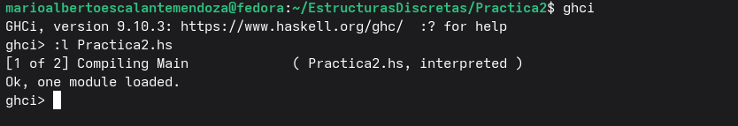

**Objetivo de la pŕactica 2:**

Conocer la sintaxis, los operadores y los tipos de datos que maneja Haskell para poder llevar a cabo la programación de funciones. También conocer algunos comandos de GHCI

**Tiempo requerido:**

Aproximadamente 3 horas

**Comentarios:**

Como tal no tuve ninguna complicación importante, las equivocaciones que tuve eran debidas principalmente a errores de sintaxis, uso equivocado de los tipos de datos o por no asignar variables.

