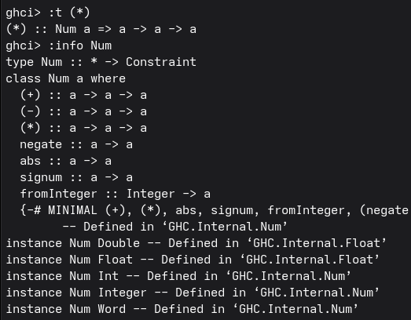

**Objetivo de la práctica**

El objetivo de la pŕactica es poder hacer mis propios tipos de datos y el uso de listas por comprensión. Además, conocer la diferencia entre una clase de tipos y un tipo.

**Tiempo requerido**

Aproximadamente 5 horas

**Ejercicio favorito**

Personalmente, me gusto definir la función soloPares. El proceso de hacer un módulo e importarlo en el archivo de la práctica me pareció interesante.

**Diferencias entre Int y Num**

La principal diferencia entre Int y Num es: Int es un tipo de dato que almacena números enteros, mientras que Num es una clase de tipos que contiene a todos los tipos de datos numéricos (comportamiento en común) , como lo son Int, Double o Float. Sabiendo esto, Num también soporta operaciones aritméticas; como la suma, la resta, la multiplicación o la división (funciones).

